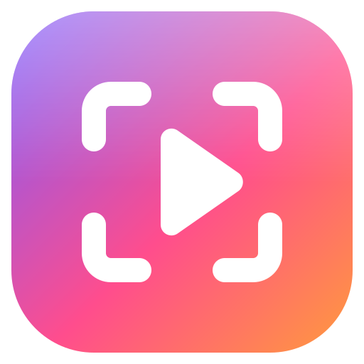
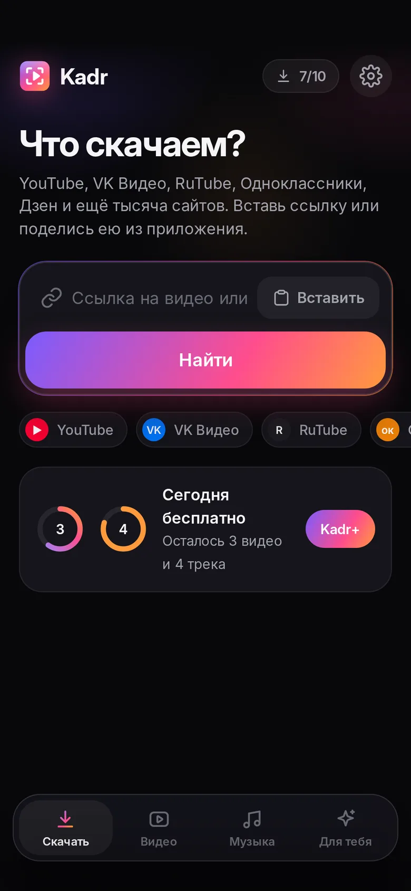
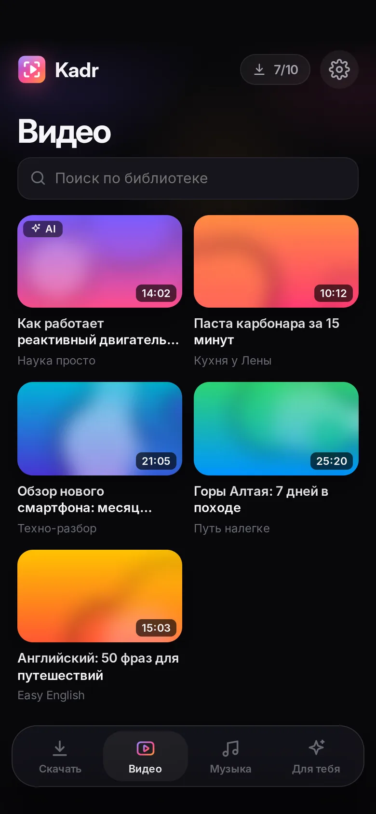
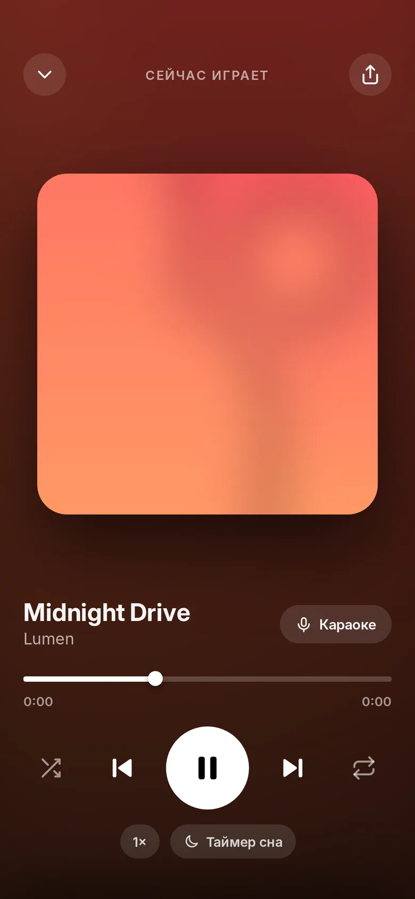

  

<h1 align="center">Kadr — видео и музыка с собой</h1>

  Сохраняй видео и музыку для офлайна, смотри в удобном плеере, 
  пой в караоке и спрашивай нейросеть о том, что видишь.

  <a href="https://zahabsbs.github.io/kadr-landing"><b>🌐 Открыть сайт</b></a>
  &nbsp;·&nbsp;
  <a href="https://github.com/Zahabsbs/kadr-landing/releases/latest/download/Kadr.apk"><b>📥 Скачать APK</b></a>
  &nbsp;·&nbsp;
  <a href="https://t.me/SkyForgeOfficial">Telegram</a>

  <b>Android 10+</b> · <b>Бесплатно</b> · <b>Без регистрации</b> · <b>0 из 66 на VirusTotal</b>

---

## Что умеет Kadr

- **Скачивание** — вставь ссылку на видео, выбери качество или только звук. YouTube, VK Видео, RuTube, Одноклассники, Дзен и ещё тысяча сайтов.
- **Плеер** — скорость 0.5×–2×, перемотка двойным тапом, продолжение с места остановки.
- **Караоке** — текст песни строчка за строчкой в такт музыке.
- **Нейросеть** — саммари видео с таймкодами, вопросы по видео, подборки для тебя. Пробно бесплатно: 3 саммари, 5 вопросов, 1 подборка.
- **Офлайн** — всё скачанное хранится на телефоне, работает без интернета.

## Скриншоты

  
  
  

## Скачать

- **APK** — [Kadr-1.1.1.apk](https://github.com/Zahabsbs/kadr-landing/releases/latest/download/Kadr.apk) (71 МБ, Android 10+). Скачай файл, открой его и разреши установку из этого источника.
- **RuStore** — на модерации, ссылка появится здесь после одобрения.

Безопасность: каждая версия проверяется на VirusTotal — 0 угроз из 66 антивирусов. [Открыть отчёт](https://www.virustotal.com/gui/file/3d33131f88684458524074bebf6d283706ed799886f46a63429ea43f911373d5).

## Отзывы

Отзывы с сайта хранятся в Supabase и проходят премодерацию. Оставить отзыв можно на сайте.

## Что внутри репозитория

Это лендинг, а не приложение: статический сайт без сборки. Все настройки — в `config.js` (ссылки, версия, ключи). `reviews.sql` — таблица отзывов для Supabase.

## Статус

- Версия: **1.1.1**
- RuStore: на модерации
- Сайт: https://zahabsbs.github.io/kadr-landing
